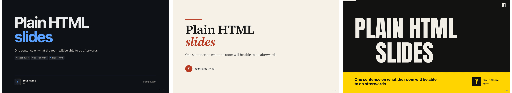
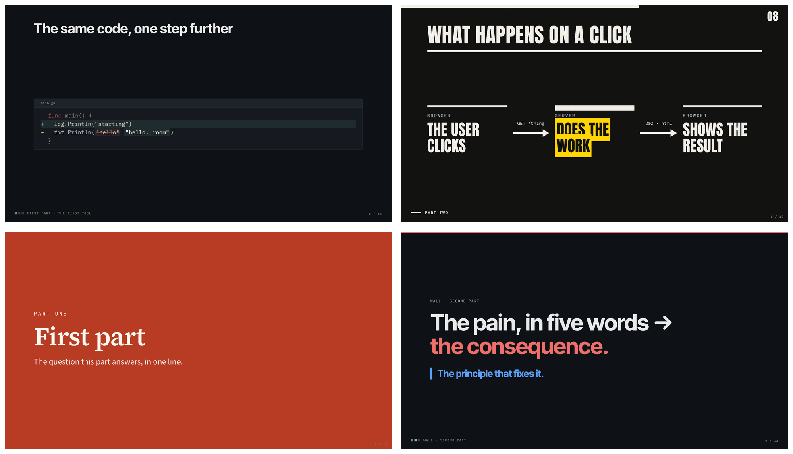
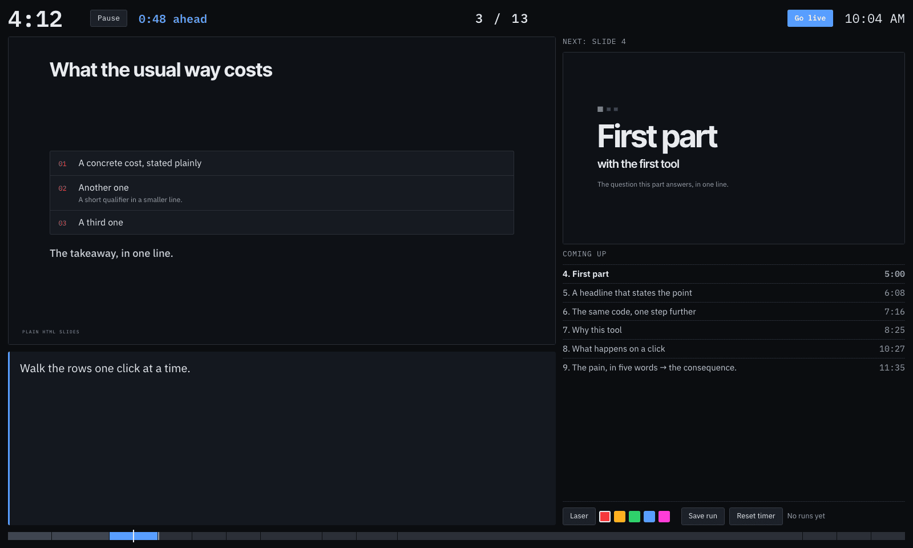

# deck

Slide decks written in plain HTML. Write and rehearse them on your laptop,
present from it, and let the room follow along on their phones.



A talk is a file of slides and a small stylesheet, so you can read it, diff
it and keep it in git next to the code it talks about. When you're done, it
builds to one HTML file with everything inside: the fonts, the images, the
video and the engine. That file opens from a USB stick on a laptop with no
network.

## What you get

- **Slides that are just HTML.** Each slide is a `<section>`. There's no
  framework to learn, and nothing to compile while you write.
- **A presenter window** with your notes, the next slide, a timer and how far
  ahead or behind you are. Save your rehearsals and it plans with how long
  each slide really took you.
- **Phones that follow along.** Put a QR code on a slide and the room sees
  your current slide and your laser pointer on their phones. They can send
  emoji reactions that float up your screen. It runs from your laptop, so
  you don't need to host anything.
- **Code that changes in front of the room.** New lines grow in, changed
  words show the old and the new, and an element can glide from one slide to
  the next.
- **A checker that reads your slides.** It flags text that runs off the
  slide, text too small or too faint to read from the back, placeholders you
  forgot, and filler phrases.
- **Three themes to start from,** and a command to make your own.



## Start

You need [Bun](https://bun.sh). In a new folder for your talks:

```sh
bun add github:grindlemire/deck
bun deck new my-talk --title "My talk"
bun deck dev
```

`new` starts `my-talk/` with a working example deck, and `dev` opens it in
your browser. It reloads as you edit and stays on the slide you were on. Add
`node_modules/` to your `.gitignore` before you commit the folder.

Two commands need one more install:

- `bun deck check` renders every slide to look for problems, so it needs a
  browser: `bunx playwright install chromium`.
- `bun deck serve` runs the follow-along server, which is written in Go:
  [install Go](https://go.dev/dl).

## Writing a talk

Slides live in `my-talk/deck/slides.html`. A slide looks like this:

```html
<section class="slide">
  <h2 class="headline">What happens on a click</h2>
  <ul>
    <li data-build>The browser asks for the page</li>
    <li data-build>The server does the work</li>
    <li data-build>The browser shows the result</li>
  </ul>
  <aside class="notes"><p>One step per click. Pause on the server.</p></aside>
</section>
```

Each `data-build` line appears on its own click. The notes show up in your
presenter window and nowhere else.

The example deck from `new` has every kind of slide the theme offers, so
the quickest start is to copy one that's close and change the words.
Press `Esc` for an overview of the whole talk. When it's done, run
`bun deck check my-talk` to check every slide in light and dark and build
`dist/index.html`, the single-file copy.

## Giving the talk



Open the deck and press `p` for the presenter window. Put it on your laptop
screen and the deck on the projector. Moving in either window moves both.

The keys you'll use most:

| Key | |
| --- | --- |
| `→` or `Space` | next (each build, then the next slide) |
| `←` | back |
| `Esc` | overview of every slide |
| `p` | presenter window |
| `l` | laser pointer; drag to draw |
| `.` or `w` | blank the screen black or white |
| `t` | light or dark |
| `?` | every key |

### With the room following on their phones

```sh
bun deck serve
```

This runs the follow-along server on your laptop and prints the link for
the audience and a key for you. Put the link on a slide as a QR code
(`bun deck qr my-talk` draws one). In the presenter window, press **Go live**
and enter the key. Only you can move the slides.

Venue Wi-Fi often stops phones from reaching a laptop. Test the QR code
from your own phone before the talk. If it fails, turn on your phone's
hotspot and have your laptop and the room join it, or host the talks.

## Hosting

Hosting is optional. Hosted, your talks get a public link and the follow-along
works on any network. `bun deck publish` writes every talk as a static site,
and [deploy/](deploy/README.md) has a Dockerfile that serves it with the
follow-along. It runs anywhere that runs a container.

## Themes

| | |
| --- | --- |
| `house` | a dark console palette with one blue accent, Inter Tight and IBM Plex. The default. |
| `paper` | light and editorial: serif headlines, warm paper, a red-orange accent. |
| `poster` | loud: condensed capitals, black and yellow, no boxes. |

Pick one with `bun deck new my-talk --theme paper`. To make your own, start
from the closest one with `bun deck theme mine --from paper`. A talk can also
change its theme's colors and fonts in its own `theme.css`.

## Writing with Claude Code

deck includes a [Claude Code](https://claude.com/claude-code) skill that
drafts a talk the way [AUTHORING.md](AUTHORING.md) describes: gather the
sources, agree on the outline, then write the slides. To use it in your
talks folder:

```sh
mkdir -p .claude/skills
ln -s ../../node_modules/@grindlemire/deck/skill .claude/skills/deck
```

## More

- [REFERENCE.md](REFERENCE.md): every command, setting, key and piece of
  slide markup
- [AUTHORING.md](AUTHORING.md): how to write a talk that's easy to follow
- [THEMES.md](THEMES.md): how themes work and how to make one
- [deploy/README.md](deploy/README.md): hosting your talks

## License

MIT. The fonts in `themes/*/fonts/` are under the SIL Open Font License;
each one's license file sits next to it.
